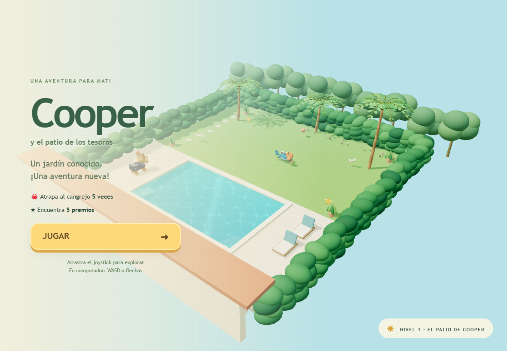
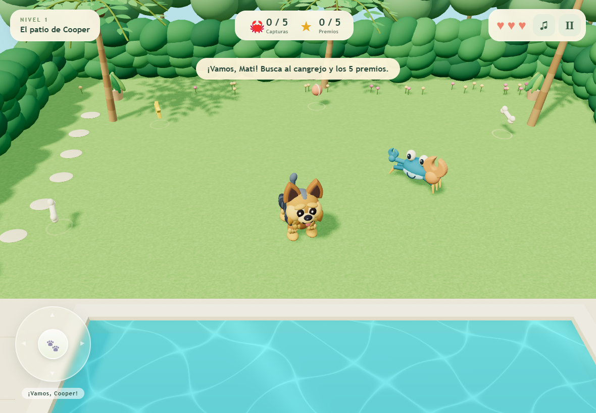

# Cooper — El patio de Cooper

Primera aventura 3D para Mati. Esta versión se desarrolla en `codex/cooper-3d-v2` y requiere revisión antes de fusionarse. No cambia la configuración de GitHub Pages ni despliega la rama de desarrollo.





## Probar sin reemplazar producción

Con Node.js 20 o posterior, desde esta carpeta:

```sh
npm run dev
```

Abrir **http://localhost:4173/juego-mati/**. No hace falta instalar paquetes para esta vista previa: Three.js está incluido localmente en `vendor/`. El servidor de desarrollo se detiene con Ctrl+C.

Para probar en un iPad conectado a la misma red, abrir `http://IP-DE-TU-PC:4173/juego-mati/` en Safari. El firewall del equipo debe permitir esa conexión local. No se ha probado físicamente en Safari para iPad.

Para revisar la rama en otro equipo:

```sh
git clone --branch codex/cooper-3d-v2 https://github.com/drhcolombia/juego-mati.git
cd juego-mati
npm run dev
```

Los módulos ES requieren HTTP; no abrir esta versión 3D con doble clic sobre `index.html`. La aplicación final sigue siendo completamente estática, sin cuentas, backend ni servicios de pago. Solo una futura fusión autorizada a `main` reemplazaría el juego publicado.

## Cómo jugar

- Arrastrar el joystick en cualquier dirección. Cuanto más lejos del centro, mayor velocidad.
- En computador: WASD o flechas; Escape pausa/reanuda.
- Atrapar cinco veces al cangrejo y recoger cinco premios para ganar.
- Rodear la tenaza cuando el cangrejo la levante. La piscina está protegida por colisiones.
- Los botones superiores permiten pausar y silenciar. Desde pausa se puede reiniciar.

## Arquitectura

- `game.js`: renderizado, cámara, ciclo de juego, IA e integración de estados.
- `src/level.js`: disposición del nivel, movimiento, colisiones y reglas comprobables sin WebGL.
- `src/input.js`: teclado y joystick con Pointer Events y captura de puntero.
- `src/models.js`: personajes originales con geometría 3D, pelaje por capas y animaciones articuladas.
- `src/world.js`: patio, piscina, vegetación y agua animada.
- `src/audio.js`: efectos sintetizados con Web Audio y ladrido grabado con alternativa sintética cuando no puede cargarse.
- `src/batch.js`: agrupación de geometría fija para reducir llamadas de dibujo.
- `vendor/`: Three.js 0.186.1, licencia MIT incluida. `npm run vendor` reproduce estos archivos después de `npm ci`.

Todos los recursos usan rutas relativas compatibles con `/juego-mati/`. Se mantienen el nombre **Cooper**, el manifiesto y el ícono original. La fotografía privada del patio no se utiliza como textura ni se incluye en el repositorio. No hay descargas de recursos en tiempo de juego ni música de terceros.

## Pruebas

```sh
npm ci
npm test
# Con la vista previa activa y Google Chrome instalado:
npm run test:browser
```

Las pruebas de navegador usan Chrome y tamaños de iPad horizontal (1180 × 820) y vertical (820 × 1180). Incluyen eventos táctiles reales vía protocolo del navegador, dos dedos, cancelación, teclado, pausa, reinicio, piscina, premios, capturas, vidas, victoria, Game Over y activación del contexto de audio. Las capturas automáticas se guardan en `test-results/` y no se versionan. Los accesos HTTP bajo `/juego-mati/` se comprueban sin errores de carga.

Limitaciones pendientes: confirmar rendimiento y audio audible en un iPad físico, ajustar sensibilidad con Matilde y validar allí la instalación desde Safari. Las pruebas de escritorio con emulación de tamaño/tacto no certifican Safari ni la velocidad de un iPad. El agua utiliza reflejos estilizados y ondas calculadas, sin reflejos costosos en tiempo real. Solo hay un nivel; los objetivos y las posiciones están concentrados en `src/level.js` para facilitar niveles futuros.

## Ladrido de Cooper (v2.2)

El botón **¡GUAU!** usa el sonido [Ladrido perro.ogg](https://commons.wikimedia.org/wiki/File:Ladrido_perro.ogg)
de Edo.pt2, publicado con licencia **CC0 1.0**. Se utiliza el MP3
transcodificado y se sube algo el tono para acercarlo al ladrido de un perro
pequeño. Si falla la descarga, se utiliza el sonido sintético local.
**La grabación no es de Cooper**: para replicar su ladrido exacto habrá que
incorporar una grabación suya.

Para confirmar que el iPad muestra la versión nueva, abrir
`https://drhcolombia.github.io/juego-mati/?v=2.2` en Safari. La portada
debe mostrar **Cooper v2.2**. Un acceso agregado a inicio puede conservar HTML
antiguo; cerrar la app desde el selector de aplicaciones y volver a abrirla.
